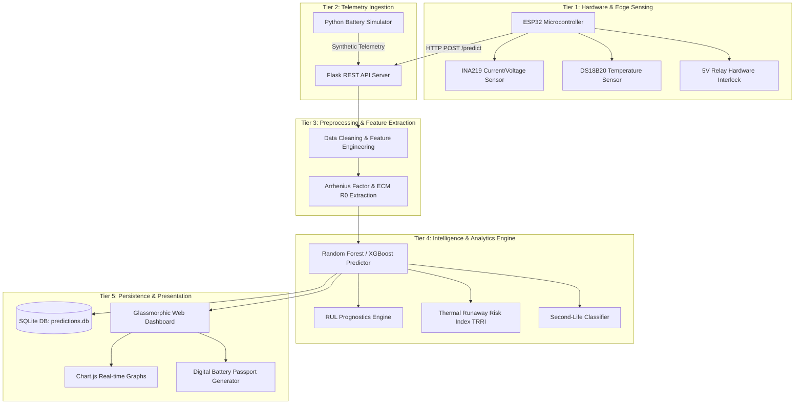

# System Architecture Specification

## 1. High-Level Architecture Overview

The system employs a **5-Tier Microservices and Layered Architecture**, clearly separating the **Offline Model Training Pipeline** from the **Real-Time Telemetry & Inference Runtime**.

```text
┌─────────────────────────────────────────────────────────────────────────────┐
│ 1. OFFLINE TRAINING PIPELINE                                                │
│                                                                             │
│  ┌──────────────────────┐      ┌──────────────────────┐      ┌────────────┐ │
│  │ NASA Battery Dataset │ ───► │  Data Preprocessing  │ ───► │ Saved Model│ │
│  │ (Raw CSV cycles)     │      │  & Feature Matrix    │      │ (rf_model) │ │
│  └──────────────────────┘      └──────────────────────┘      └─────┬──────┘ │
└────────────────────────────────────────────────────────────────────┼────────┘
                                                                     │
┌────────────────────────────────────────────────────────────────────┼────────┐
│ 2. REAL-TIME RUNTIME & TELEMETRY PIPELINE                          │
│                                                                    ▼        │
│  ┌──────────────────────┐         ┌───────────────────┐    ┌──────────────┐ │
│  │ ESP32 / Telemetry    │ ──────► │ Flask REST API    │ ◄─►│ Trained ML   │ │
│  │ Sensors (V, I, T)    │ (HTTP)  │ (app.py :5000)    │    │ Inference    │ │
│  └──────────┬───────────┘         └─────────┬─────────┘    └──────────────┘ │
│             │                               │                               │
│             ▼                               ▼                               │
│  ┌──────────────────────┐         ┌───────────────────┐                     │
│  │ Hardware Relay       │         │ SQLite DB         │                     │
│  │ Cutoff (<100ms)      │         │ (predictions.db)  │                     │
│  └──────────────────────┘         └─────────┬─────────┘                     │
│                                             │                               │
│                                             ▼                               │
│                                   ┌───────────────────┐                     │
│                                   │ Live Web Dashboard│                     │
│                                   │ (Charts & Passport│                     │
│                                   └───────────────────┘                     │
└─────────────────────────────────────────────────────────────────────────────┘
```

---

## 2. Mermaid Structural Tier Architecture



---

## 3. Tier Descriptions & Specifications

1. **Hardware & Edge Sensing Tier:**
   - **ESP32 Microcontroller:** Samples sensors at 10 Hz and handles local safety logic.
   - **INA219 & DS18B20 Sensors:** Measures pack voltage ($V$), current load ($I$), and cell temperature ($T$).
   - **Hardware Interlock Relay:** Autonomously trips in `<100ms` if local cell temperature exceeds safe thresholds ($>45^\circ\text{C}$).

2. **Telemetry Ingestion Tier:**
   - Ingests HTTP JSON telemetry payloads from physical ESP32 hardware or simulation scripts via the Flask endpoint `/predict`.

3. **Preprocessing & Feature Engineering Tier:**
   - Cleans incoming data streams, applies scaling via pre-computed `StandardScaler`, and computes dynamic indicators such as internal resistance ($R_0$) and thermal acceleration rate.

4. **Intelligence & Analytics Tier:**
   - **SoH Inference Engine:** Predicts battery State-of-Health (%) with high accuracy ($R^2 > 0.98$).
   - **RUL Prognostics:** Estimates remaining charge cycles and distance (km) before reaching 80% EoL boundary.
   - **Thermal Runaway Risk Index (TRRI):** Evaluates thermal escalation risk.
   - **Second-Life Classifier:** Categorizes degraded cells into Grade A (Prime EV), Grade B (Agricultural Solar Repurposing), or Grade C (Recycling).

5. **Persistence & Presentation Tier:**
   - **SQLite Database (`predictions.db`):** Maintains full prediction log in the `prediction_history` table.
   - **Glassmorphic Web Dashboard:** Displays real-time dual gauges, chemistry switcher (NMC vs LFP), interactive charts, and downloadable battery passport certificates.

